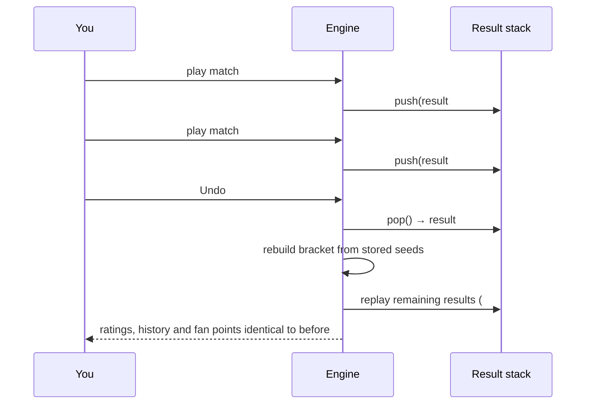
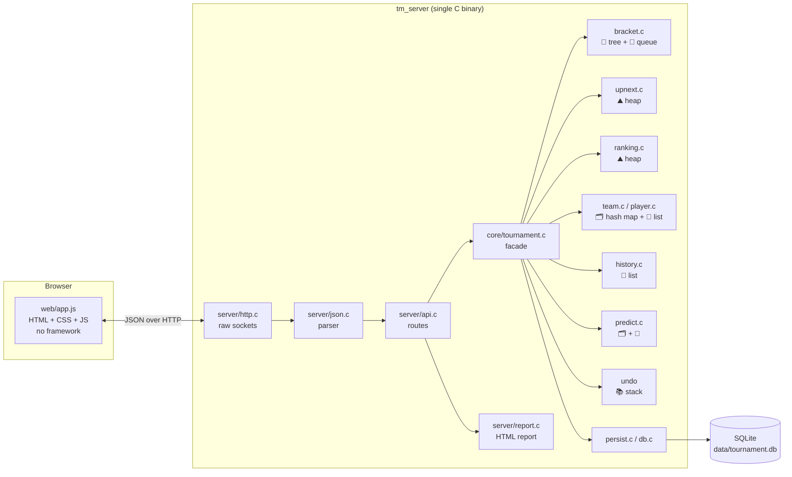

<div align="center">

```
 ████████╗ ██████╗ ██╗   ██╗██████╗ ███╗   ██╗ █████╗ ███╗   ███╗███████╗███╗   ██╗████████╗
 ╚══██╔══╝██╔═══██╗██║   ██║██╔══██╗████╗  ██║██╔══██╗████╗ ████║██╔════╝████╗  ██║╚══██╔══╝
    ██║   ██║   ██║██║   ██║██████╔╝██╔██╗ ██║███████║██╔████╔██║█████╗  ██╔██╗ ██║   ██║
    ██║   ██║   ██║██║   ██║██╔══██╗██║╚██╗██║██╔══██║██║╚██╔╝██║██╔══╝  ██║╚██╗██║   ██║
    ██║   ╚██████╔╝╚██████╔╝██║  ██║██║ ╚████║██║  ██║██║ ╚═╝ ██║███████╗██║ ╚████║   ██║
    ╚═╝    ╚═════╝  ╚═════╝ ╚═╝  ╚═╝╚═╝  ╚═══╝╚═╝  ╚═╝╚═╝     ╚═╝╚══════╝╚═╝  ╚═══╝   ╚═╝
                           M   A   N   A   G   E   R
```

### ⚽ Run your football cup. From first whistle to final. 🏆

**A full knockout-cup simulator whose every feature is powered by a data structure written from scratch in C.**<br>
No STL. No libraries for containers. No Node, no Python, no npm. Just `gcc`, a socket and a browser.

<br>


<br>

[**🚀 Quick start**](#-quick-start) · [**🧠 The six data structures**](#-the-six-data-structures) · [**🏗 Architecture**](#-architecture) · [**🎬 Demo**](#-3-minute-demo-walkthrough) · [**🔌 API**](#-json-api) · [**👥 Team**](#-team)

</div>

---

## 🔥 What is this?

Tournament Manager lets you register clubs and squads, seed and draw a knockout bracket, play or simulate matches, let fans stake virtual points on results, **undo any result**, and download a full HTML report of the cup.

The twist: it is a **Data Structures mini project**, so nothing is a black box. A built-in **C engine trace console** prints every hash lookup, heap push, queue pop and stack operation behind each click you make, live, in the browser.

```
 click "Generate bracket"        (illustrative trace, the real console prints the live values)
   │
   ├─ heap_push  ▸ Velvet Cobras FC   (rating 1814)      ← seeding, max-heap
   ├─ heap_push  ▸ Silver Sharks FC   (rating 1672)
   ├─ heap_pop   ▸ seed #1 = Velvet Cobras FC             O(log n)
   ├─ queue_push ▸ match #1 (round of 32)                 ← level-order build
   ├─ queue_pop  ▸ match #1  → create children
   └─ tree built: 31 matches, 5 rounds, parent pointers linked
```

## ✨ Features

| | |
|---|---|
| 🏟 **Clubs & squads** | GK / DEF / MID / FWD, shirt numbers, up to 25 players per club. Duplicates rejected instantly. |
| 🧩 **Bracket** | Single elimination for **2, 4, 8, 16 or 32 clubs** (register up to 64, start the cup when the count is right). Clubs are seeded so the best sides meet as late as possible. |
| 🎲 **Play or simulate** | Enter a score, or simulate one match, one round, or the **whole cup** (strength-weighted). |
| 📈 **Live strength** | Elo-style ratings update after every result. |
| ⏪ **Undo anything** | Undo any result. Ratings, history and fan points roll back consistently (event sourcing). |
| 🔮 **Fan predictions** | Virtual points only, no real money. Back the underdog and it pays more. One prediction per fan per match. |
| 📊 **Tables** | Cup standings, club strength table, fan leaderboard, per-club history, activity feed. |
| 💾 **Persistence** | SQLite storage plus an exportable replay log. |
| 📄 **Report** | One click downloads a self-contained HTML tournament report. |
| 🔬 **X-ray mode** | Live visualisation of hash buckets, the heap and the undo stack, plus the C engine trace console. |

## 🧠 The six data structures

> Every structure below is hand-written. The five generic containers in `src/ds/` total **288 lines including headers**.

| # | Structure | Where it works | Cost | Source |
|:-:|---|---|:-:|---|
| 1 | 🗂 **Hash map** (chaining, FNV-1a, rehash at 0.75 load) | Club, player and fan lookup. Rejects duplicate clubs and players. One prediction per fan per match. | `O(1)` avg | `src/ds/hashmap.c` |
| 2 | 🔗 **Doubly linked list** | Club registry, squads, match history (newest first), fans, predictions, activity feed. | `O(1)` add / unlink | `src/ds/linkedlist.c` |
| 3 | 🌳 **Binary tree** | The bracket itself. Each match has `left`, `right`, `parent`. Winners climb via `parent`. | `O(1)` advance | `src/core/bracket.c` |
| 4 | 🚶 **Queue** (circular, growable) | Builds the tree level by level. Level-order export. | `O(1)` | `src/ds/queue.c` |
| 5 | ⛰ **Binary heap** (comparator based) | Seeding, "Up next", cup standings, strength table, fan leaderboard. | `O(log n)` | `src/ds/heap.c` |
| 6 | 📚 **Stack** | Undo. Every played result is pushed. | `O(1)` | `src/ds/stack.c` |

### 🗂 Hash map: "does this club exist?"

```
 (illustrative)
 "Arsenal" ──lowercase──▶ "arsenal" ──FNV-1a──▶ 32-bit hash ──mod bucket count──▶ bucket 13
                                                                        │
   bucket 13 ──▶ [ arsenal ] ──▶ [ aston villa ]   ← chaining on collision
   load factor > 0.75  ⇒  table doubles and every key is rehashed
```

`Arsenal` and `arsenal` are the same club. Duplicate player names inside a club are rejected by the same table.

### 🔗 Linked list: order without shifting

```
 NULL ◀─ [ Arsenal ] ⇄ [ Iron Wolves ] ⇄ [ Solar Drakes ] ─▶ NULL
              adding or removing a node only rewrites two pointers: nothing shifts
```

Match history uses `push_front` so the newest result is always on top, in `O(1)`.

### ⛰ Binary heap: "who is best, right now?"

```
 max-heap by rating                     stored as an array
         1814                          [1814, 1672, 1590, 1540, 1488, 1501, 1455]
        /    \                          parent(i) = (i-1)/2     children = 2i+1, 2i+2
     1672    1590
     /  \    /  \                        push  → sift up      O(log n)
  1540 1488 1501 1455                    pop   → sift down    O(log n)
```

One heap implementation, five jobs, five comparison functions:

| Job | Priority rule | Type |
|---|---|---|
| Seeding | highest starting rating first | max-heap |
| Up next | earliest round, then earliest position | **min**-heap |
| Strength table | highest live Elo rating | max-heap |
| Cup standings | furthest round, then goal difference, wins, rating | max-heap |
| Fan leaderboard | most points | max-heap |

### 🚶 Queue + 🌳 Tree: building the bracket

The tree is **not** built recursively. A queue builds it breadth first, one round at a time, from the final backwards to the first round.

```
 8-club cup, built backwards from the final:

 queue:  [Final]
 pop Final  → push SF1, SF2
 pop SF1    → push QF1, QF2
 pop SF2    → push QF3, QF4
 ...

                    QF1 ─┐
                         ├─ SF1 ─┐
                    QF2 ─┘       │
                                 ├─ FINAL
                    QF3 ─┐       │
                         ├─ SF2 ─┘
                    QF4 ─┘
```

When a match finishes, the winner moves to `match->parent` in `O(1)`. The same queue also gives the **level-order export** of the whole cup.

### 📚 Stack: how undo really works



This is **event sourcing**: ratings, history and fan points are never patched by hand. They are always recomputed from the stack, so they cannot drift out of sync.

## 🏗 Architecture



The browser is a thin view. All the logic, all the structures and all the numbers live in the C engine.

## 🚀 Quick start

### Requirements
- **GCC** (MinGW-w64 on Windows via MSYS2 / winlibs, or any GCC / Clang on Linux and macOS)
- **SQLite3** development library (`libsqlite3`)
- A web browser

### Windows
Double-click **`run.bat`**. It builds with `build.bat` if needed, then opens your browser.

> If you get `libsqlite3-0.dll was not found`, add your MSYS2 `ucrt64\bin` folder to `PATH` (for example `C:\msys64\ucrt64\bin`).

### Linux / macOS
```bash
make
./tm_server --open        # or browse to http://localhost:8080
```

Run it from the project folder: the server serves `./web`.

### Options
```
tm_server [--port 8080] [--web web] [--save data/tournament.db] [--open] [--seed N]
```

| Flag | Meaning |
|---|---|
| `--port` | HTTP port (default `8080`) |
| `--web` | Folder with the UI files |
| `--save` | SQLite file for persistence |
| `--open` | Open the browser on start |
| `--seed N` | Fixed RNG seed, so simulations are **reproducible** |

### No browser? Use the terminal
```bash
./tm_cli 8 3        # 8 clubs, seed 3: whole cup in the terminal
make test           # unit tests for the data structures and the engine
```

## 🎬 3-minute demo walkthrough

| Step | Do this | Structure you are seeing |
|:-:|---|---|
| 1 | Click **Quick demo** (or *Create your own*) | 🗂 hash map registers clubs, 🔗 list keeps order |
| 2 | Open a club, add players or *Fill sample squad* | 🔗 squad list, 🗂 duplicate check |
| 3 | **Generate bracket**, open the trace console | ⛰ heap seeds, 🚶 queue builds, 🌳 tree links |
| 4 | **Up next** tab | ⛰ min-heap |
| 5 | **Predictions** tab: add a fan, stake points on a ready match | 🗂 one pick per fan per match, ⛰ leaderboard |
| 6 | **Simulate** a match | 🌳 winner climbs through `parent`, 📚 result pushed |
| 7 | Click **Undo** | 📚 pop, rebuild, replay |
| 8 | **Sim all**, open **Tables** and **History** | ⛰ standings, 🔗 `push_front` history |
| 9 | **Download report** | the whole cup as one HTML file |

## 🔌 JSON API

The browser talks to the engine through a small JSON API, so you can drive the cup from `curl` too.

```bash
curl -s localhost:8080/api/state | head -c 300
curl -s -X POST localhost:8080/api/demo   -d '{"teams":8}'
curl -s -X POST localhost:8080/api/generate
curl -s -X POST localhost:8080/api/simall
curl -s localhost:8080/api/report -o report.html
```

<details>
<summary><b>All endpoints (click to expand)</b></summary>

| Endpoint | Body | Effect |
|---|---|---|
| `GET /api/state` | | Full state: clubs, bracket, tables, fans, history, DS stats, trace |
| `GET /api/report` | | Download the HTML tournament report |
| `GET /api/export` | | Download the replay log |
| `POST /api/create` | `name` | New cup in setup phase |
| `POST /api/team`, `/api/team/remove` | `name, rating` / `id` | Add / remove a club |
| `POST /api/fill` | `count` | Add sample clubs |
| `POST /api/player`, `/api/player/remove` | `teamId, name, pos, number` / `id` | Add / remove a player |
| `POST /api/squad/fill` | `teamId?` | Sample squad(s) |
| `POST /api/generate` | | Seed, build tree, resolve byes |
| `POST /api/play` | `matchId, scoreA, scoreB` | Record a result |
| `POST /api/sim`, `/simround`, `/simall` | `matchId?` | Simulate |
| `POST /api/undo` | | Undo last result |
| `POST /api/fan`, `/api/fan/fill` | `name` / none | Add fans |
| `POST /api/predict` | `fanId, matchId, pickId, stake` | Stake virtual points |
| `POST /api/demo`, `/api/reset` | `teams` | Quick demo / discard |

</details>

## 🗺 Project map

```
Tournament_Manager_mini_project/
├── web/                     🖥  Browser UI (index.html, app.js, style.css)
├── src/
│   ├── main.c               ▶  Server entry point
│   ├── cli.c                ⌨  Terminal demo
│   ├── server/              🌐 http.c (sockets) · json.c (parser) · api.c (routes) · report.c (HTML report)
│   ├── core/                🧠 Domain logic
│   │   ├── types.h              shared structs
│   │   ├── tournament.c         facade: create, add club, generate, play, sim, undo
│   │   ├── bracket.c            seeding, tree build, advancement      🌳 + 🚶
│   │   ├── upnext.c             next ready match                      ⛰
│   │   ├── team.c / player.c    clubs, squads, strength maths         🗂 + 🔗
│   │   ├── history.c            activity feed, result records         🔗
│   │   ├── ranking.c            standings and strength table          ⛰
│   │   ├── predict.c            fans, predictions, virtual points     🗂 + 🔗
│   │   └── persist.c / db.c     replay log and SQLite storage
│   ├── ds/                  🧱 hashmap · linkedlist · queue · stack · heap
│   └── util/                🔧 memory helpers, string buffer, RNG, trace log
├── tests/                   ✅ test_ds.c · test_core.c
├── Makefile · build.bat · run.bat
└── DATA_STRUCTURES.md       📖 deeper write-up of all structures
```

**By the numbers:** about 2,400 lines of C in `src/` plus 230 lines of tests, about 620 lines of vanilla web code, 0 third-party frameworks.

## 🧪 Tests

```bash
make test
```

- `tests/test_ds.c` tests the containers on their own: 500 hash inserts that force rehashing, lookup and removal, linked list, queue wrap-around and growth with FIFO order kept, stack, and a heap that sorts 1000 random numbers.
- `tests/test_core.c` tests the engine: case-insensitive duplicate clubs, the 2/4/8/16/32 club rule, seeding and bracket build, match validation and advancement, undo and redo, a full run for every cup size, a persistence round trip that reproduces the same champion and ratings, squad rules (duplicate names, shirt numbers, 25-player limit) and prediction rules (stake limits, one pick per fan per match, settlement, undo).

## 🚧 Limits

Single elimination. A cup starts with exactly 2, 4, 8, 16 or 32 clubs (up to 64 can be registered), up to 25 players per club, up to 64 fans, one active cup, no draws in knockout matches. The server is single-threaded and binds to localhost only.

## 👥 Team

Six structures, three people, two structures each.

| | Member | Owns | Structures |
|:-:|---|---|---|
| 🌳 | **Shreyas** | Cup bracket, tournament flow | Binary tree · Queue |
| 🗂 | **Jatin** | Clubs and players | Hash map · Linked list |
| ⛰ | **Shaun** | Tables, undo, predictions, UI | Heap · Stack |

## 🔮 Future ideas

- Double elimination
- Round-robin groups with a heap-based live table
- Third-place playoff

<div align="center">

<br>

**Built from scratch in C. Every click is a data structure.** ⚽

</div>
